# PostgreSQL 객체 관리 · 트랜잭션 · Supabase SDK 연동

쇼핑몰의 **회원 · 상품 · 주문(+주문상품)** 을 주제로 PostgreSQL(Supabase)를 설계하고,  
제약조건·트랜잭션·RLS(행 단위 보안)를 적용한 뒤 Python SDK(uv 환경)로 CRUD를 구현했습니다.

- 도구: Python 3.13, uv, Supabase(PostgreSQL), `supabase` · `python-dotenv`
- 모든 결과는 실제 실행 결과입니다. 화면은 `docs/images`, 데모 출력 텍스트는 `docs/outputs`에 있습니다.

> **목차**  
> 1. [주요 구현항목](#1-주요-구현항목)
> 2. [프로젝트 구조](#2-프로젝트-구조)
> 3. [DB 설계](#3-db-설계)
> 4. [데이터 변경과 검증](#4-데이터-변경과-검증)
> 5. [트랜잭션](#5-트랜잭션)
> 6. [Supabase SDK CRUD](#6-supabase-sdk-crud)
> 7. [RLS와 인증](#7-rls와-인증)
> 8. [예외 처리](#8-예외-처리)
> 9. [실행 방법](#9-실행-방법)
<br />
## 1. 주요 구현항목

| 항목 | 요약 | 관련 |
|---|---|---|
| 테이블 및 객체 생성 | 4개 테이블, 제약 19개, CREATE·ALTER·DROP, 명명 규칙, 정규화 | [`sql/schema.sql`](sql/schema.sql), [`sql/reset.sql`](sql/reset.sql) · [아래 3장](#3-db-설계) |
| 데이터 변경 및 검증 | INSERT·UPDATE·DELETE 전후 비교, 제약 위반 시도 11건 | [`sql/dml_verify.sql`](sql/dml_verify.sql) · [아래 4장](#4-데이터-변경과-검증) |
| 트랜잭션 정합성 | COMMIT·ROLLBACK, 중간 실패 시 부분 반영 없음 | [`sql/transaction.sql`](sql/transaction.sql) · [아래 5장](#5-트랜잭션) |
| Supabase 연동 | 회원·상품·주문 CRUD, RLS·인증(권한 정책), 예외 처리 | [`src/shoppingmall_db/`](src/shoppingmall_db), [`sql/rls.sql`](sql/rls.sql) · [아래 6장](#6-supabase-sdk-crud) |

## 2. 프로젝트 구조

```text
├── sql/
│   ├── reset.sql            # 테이블 전부 삭제(DROP)
│   ├── schema.sql           # CREATE / ALTER / 제약조건 / 인덱스
│   ├── seed.sql             # 예시(가짜) 데이터. 실행하면 초기화됨
│   ├── dml_verify.sql       # INSERT / UPDATE / DELETE 전후 검증 + 제약 위반 시도
│   ├── transaction.sql      # COMMIT / ROLLBACK / 실패 재현
│   ├── order_function.sql   # 주문 생성·취소 DB 함수(원자적 처리)
│   └── rls.sql              # RLS 켜기 + 정책
├── src/shoppingmall_db/     # client, products, users, orders, auth, errors
├── scripts/                 # 데모(demo_crud.py 등)
├── docs/images/             # 데모 실행 화면
├── docs/outputs/            # 데모 실행 출력(텍스트)
└── .env.example             # 필요한 환경변수 이름
```

## 3. DB 설계

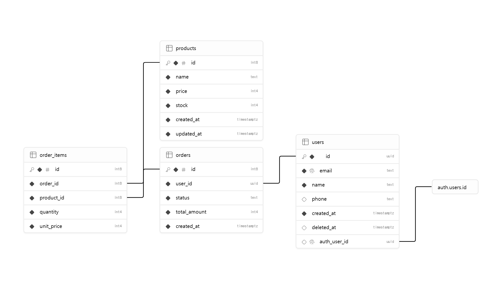

### users (회원)

- 로그인 계정은 시드 회원이 로그인 계정 없이 존재해야 해서 `users.id`를 `auth.users.id`와 같게 하지 않기 위해 `users.auth_user_id` 로 연결했습니다.
- 회원은 `deleted_at`으로 탈퇴 처리해 주문 기록을 보존합니다. 

| 컬럼 | 타입 | 제약 |
|---|---|---|
| `id` | uuid | **PK** `pk_users`, 기본값 `gen_random_uuid()` |
| `email` | text | NOT NULL, **UNIQUE** `uq_users_email`, CHECK `ck_users_email_format` |
| `name` | text | NOT NULL |
| `phone` | text | NULL 허용 |
| `created_at` | timestamptz | NOT NULL, 기본값 `now()` |
| `deleted_at` | timestamptz | NULL이면 활성, 값이 있으면 탈퇴(소프트삭제) |
| `auth_user_id` | uuid | **UNIQUE** `uq_users_auth_user_id`, **FK** `fk_users_auth_users` → `auth.users(id)` (`on delete set null`) |

### products (상품)

- 상품은 주문에 들어 있으면 FK(`restrict`)가 삭제를 막아 이력이 이미 보호됩니다.

| 컬럼 | 타입 | 제약 |
|---|---|---|
| `id` | bigint | **PK** `pk_products`, identity |
| `name` | text | NOT NULL, CHECK `ck_products_name_not_blank` |
| `price` | integer | NOT NULL, CHECK `ck_products_price_nonneg` (≥ 0) |
| `stock` | integer | NOT NULL, 기본값 0, CHECK `ck_products_stock_nonneg` (≥ 0) |
| `created_at` | timestamptz | NOT NULL, 기본값 `now()` |
| `updated_at` | timestamptz | NOT NULL, 기본값 `now()` (**ALTER**로 추가) |

### orders (주문)

| 컬럼 | 타입 | 제약 |
|---|---|---|
| `id` | bigint | **PK** `pk_orders`, identity |
| `user_id` | uuid | NOT NULL, **FK** `fk_orders_users` → `users(id)` (`on delete restrict`) |
| `status` | text | NOT NULL, 기본값 `pending`, CHECK `ck_orders_status` (`pending`/`paid`/`shipped`/`canceled`) |
| `total_amount` | integer | NOT NULL, 기본값 0, CHECK `ck_orders_total_nonneg` |
| `created_at` | timestamptz | NOT NULL, 기본값 `now()` |

### order_items (주문상품)

- 주문 하나에 상품이 여러 개 담기는 특성을 고려해 정규화 목적으로 `orders`와 `order_items`로 테이블을 나눴습니다.

| 컬럼 | 타입 | 제약 |
|---|---|---|
| `id` | bigint | **PK** `pk_order_items`, identity |
| `order_id` | bigint | NOT NULL, **FK** `fk_order_items_orders` → `orders(id)` (`on delete cascade`) |
| `product_id` | bigint | NOT NULL, **FK** `fk_order_items_products` → `products(id)` (`on delete restrict`) |
| `quantity` | integer | NOT NULL, CHECK `ck_order_items_quantity_positive` (> 0) |
| `unit_price` | integer | NOT NULL, CHECK `ck_order_items_unit_price_nonneg`. 주문 시점 가격을 복사해 저장 |
| (복합) | | **UNIQUE** `uq_order_items_order_product` (`order_id`, `product_id`) |

## 4. 데이터 변경과 검증

- [`sql/dml_verify.sql`](sql/dml_verify.sql)을 블록별로 실행합니다.
  - 변경 전 조회 → INSERT → UPDATE → DELETE → 전후 검증 → 제약 위반 시도  
- 시드는 [`sql/seed.sql`](sql/seed.sql)이며, 11건 모두 제약 이름과 함께 거절되어야 정상입니다.

| INSERT | UPDATE | DELETE |
|---|---|---|
| 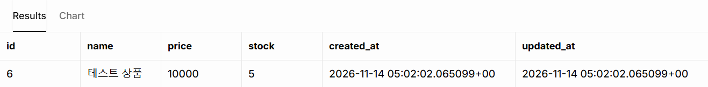 | 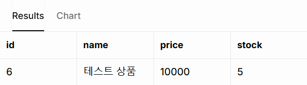 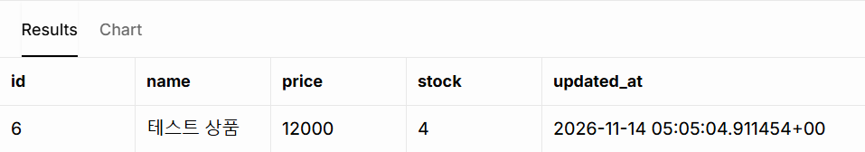 | 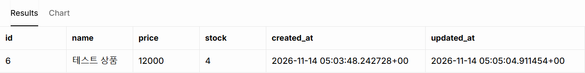 |

| 시도 | 막는 제약 |
|---|---|
| 가격 음수 / 이름 공백 / 이름 NULL | `ck_products_price_nonneg` / `ck_products_name_not_blank` / NOT NULL |
| 이메일 중복 / 이메일 형식 오류 | `uq_users_email` / `ck_users_email_format` |
| 주문 상태가 규칙 밖 / 없는 회원의 주문 | `ck_orders_status` / `fk_orders_users` |
| 수량 0 / 같은 주문에 같은 상품 두 줄 | `ck_order_items_quantity_positive` / `uq_order_items_order_product` |
| 주문 있는 회원 삭제 / 주문된 상품 삭제 | `fk_orders_users` / `fk_order_items_products` |

제약 위반 시도를 하면 아래와 같은 화면을 확인할 수 있습니다.

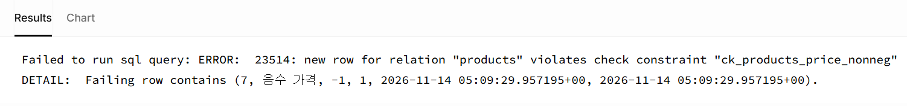
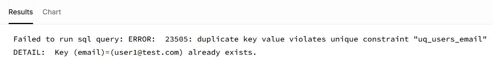
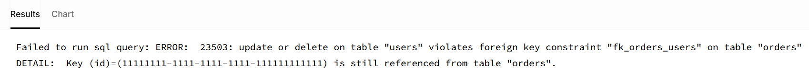

## 5. 트랜잭션

- [`sql/transaction.sql`](sql/transaction.sql) : 한 번의 실행 안에서 `BEGIN`부터 `COMMIT`/`ROLLBACK`까지 처리합니다.
- Supabase SDK는 호출 하나하나가 따로 처리되어 여러 테이블을 묶을 수 없습니다. 
- 그래서 주문 생성(주문 저장 + 주문상품 저장 + 재고 차감 + 합계 기록)과 취소(재고 복구)를 DB 함수 [`create_order` / `cancel_order`](sql/order_function.sql)로 만들고 SDK는 `rpc`로 한 번만 호출합니다. 

| 시나리오 | 결과 | 화면 |
|---|---|---|
| 1. 주문 생성 → `COMMIT` | 주문·주문상품·재고 차감·합계가 모두 확정 (합계 79,900) | 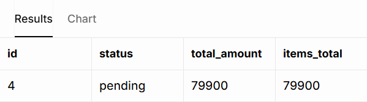 |
| 2. 변경 후 `ROLLBACK` | 1번 재고가 50 그대로 | 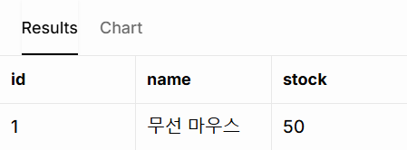 |
| 3. 중간 오류 → 전체 취소 | 첫 `UPDATE`가 성공해도 둘째 문장이 `ck_products_stock_nonneg` 위반으로 실패하면 전부 취소 | 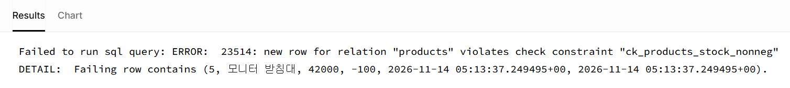 |
| 3-1. 검증 | 부분 반영 없음 (1번 50, 2번 30, 5번 0) | 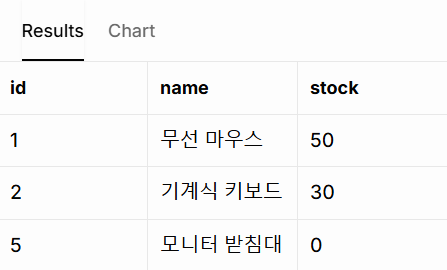 |

## 6. Supabase SDK CRUD

- `src/shoppingmall_db/`의 `products.py`, `users.py`, `orders.py`가 각각 CRUD를 제공합니다. 
- 데모는 관리자로 로그인한 뒤 실행해야 합니다.

|  | 만들기 | 읽기 | 고치기 | 지우기 |
|---|---|---|---|---|
| 상품 | `create_product` | `get_product`, `list_products` | `update_product` | `delete_product` |
| 회원 | `create_user` | `get_user`, `get_user_by_email`, `list_users` | `update_user` | `delete_user`, `restore_user` |
| 주문 | `create_order` | `get_order`, `list_orders` | `update_order_status` | `cancel_order` |

- 실행 결과는 아래 링크에서 확인할 수 있습니다. (`demo_crud.txt` 한 파일에 세 구간이 이어서 출력됩니다.)

| 구간 | 보여주는 것 | 결과 |
|---|---|---|
| 상품 CRUD | 생성·조회·수정·삭제, 음수 가격 거절, 주문된 상품 삭제 거절 | [`demo_crud.txt`](docs/outputs/demo_crud.txt#L3-L45) |
| 회원 CRUD | 소프트삭제·복구, 삭제 후 조회에서 제외, 삭제 시 주문 수 유지 | [`demo_crud.txt`](docs/outputs/demo_crud.txt#L47-L115) |
| 주문 CRUD + 트랜잭션 | 생성 → 상태 변경 → 취소 및 재고 복구, 재고 부족 시 전체 취소 | [`demo_crud.txt`](docs/outputs/demo_crud.txt#L117-L173) |

## 7. RLS와 인증

- RLS를 4개 테이블에 적용했고(정책 10개), 로그인한 사람의 권한으로 요청이 처리됩니다.  
- 관리자는 JWT의 `app_metadata.role = 'admin'`으로 구분합니다. (사용자 스스로 변경 불가)
- 같은 `list_orders()` 호출이 누가 요청하느냐에 따라 다른 결과를 돌려줍니다. 
- 실행 결과는 [`docs/outputs/demo_rls.txt`](docs/outputs/demo_rls.txt)에서 확인 가능합니다.
  - 비회원 상태 : [02~09행](docs/outputs/demo_rls.txt#L2-L9)
  - 로그인 계정 : [11~24행](docs/outputs/demo_rls.txt#L11-L24)
  - 관리자 계정 : [26~31행](docs/outputs/demo_rls.txt#L26-L31)
 - 막힌 `UPDATE`·`DELETE`는 오류가 아니라 0행으로 처리됩니다. (함수가 `None` 반환)
 - 주문 생성·취소는 `security definer`이며 함수 안에서 호출자가 본인(관리자)인지 직접 검사합니다.
- 한계 : `service_role` 키는 RLS를 우회하므로 사용하지 않았고, 컬럼 단위 수정 제한은 하지 않았습니다.

<table>
<tr>
<td valign="top">

| 테이블 | 비로그인 | 회원 로그인 | 관리자 로그인 |
|---|---|---|---|
| `products` | 읽기 | 읽기 | 읽기·쓰기 |
| `users` | 없음 | 본인 행만 읽기·수정 | 전체 |
| `orders` | 없음 | 본인 주문만 읽기 | 전체 |
| `order_items` | 없음 | 본인 주문의 줄만 읽기 | 전체 |
| 주문 생성·취소(DB함수) | 불가 | 본인 주문만 | 전체 |

</td>
<td valign="top">

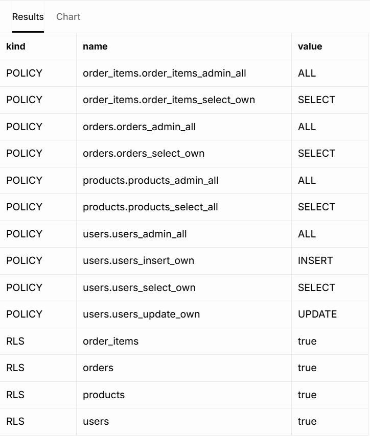

</td>
</tr>
</table>

## 8. 예외 처리

- DB가 거절하면 SDK는 `APIError(code, message)`를 던집니다. 
- [`errors.py`](src/shoppingmall_db/errors.py)는 DB가 던지는 `APIError`를 종류별 예외로 변환(`@translate_errors`)하고 던집니다.
  - 변환된 예외는 모두 `ParentError`의 자식이므로 부모로 한 번에 잡을 수 있습니다.
- 실행 결과는 [`docs/outputs/demo_errors.txt`](docs/outputs/demo_errors.txt)에서 확인 가능합니다.
  - 비회원 상태 : [02~10행](docs/outputs/demo_errors.txt#L2-L10) (권한 없음, 로그인 실패)
  - 관리자 계정 : [12~48행](docs/outputs/demo_errors.txt#L12-L48) (중복, CHECK, NOT NULL, 사용 중, 업무 규칙, 종류별 처리)

| 예외 | DB 코드 | 예외 발생 상황 예시 |
|---|---|---|
| `DuplicateError` | `23505` | 이미 있는 이메일 |
| `InvalidValueError` | `23514`, `23502` | 음수 가격, 이름 없음 |
| `InUseError` | `23503` | 주문된 상품 삭제 |
| `PermissionDeniedError` | `42501` | RLS가 막음 |
| `BusinessRuleError` | `P0001` | 재고 부족 (DB 함수의 `raise exception`) |
| `AuthenticationError` | - | 로그인 실패 |

## 9. 실행 방법


1. **준비**: Python 3.13, uv, Supabase

2. **설치**: uv sync  

3. **환경변수 설정**: `.env.example`을 복사해 `.env`로 만들고 값을 채웁니다.

   ```text
   SUPABASE_URL=https://<프로젝트>.supabase.co
   SUPABASE_KEY=<공개용 키 (publishable / anon)>
   DEMO_USER_EMAIL=demo-user@test.com
   DEMO_ADMIN_EMAIL=demo-admin@test.com
   DEMO_PASSWORD=<임의의 비밀번호>
   ```
4. **Supabase Authentication 데모 계정** : 회원, 관리자 계정 각 1개씩 Auto Confirm User로 생성
5. **SQL문 실행 순서** (Supabase SQL Editor Run)
   1) `sql/reset.sql` (이미 테이블이 있는 경우, 필요한 상황에서만 사용)
   2) `sql/schema.sql`
   3) `sql/rls.sql`
   4) `sql/order_function.sql`
   5) 관리자 권한 부여
      ```sql
      update auth.users
      set raw_app_meta_data = coalesce(raw_app_meta_data, '{}'::jsonb) || '{"role": "admin"}'::jsonb
      where email = 'demo-admin@test.com';
      ```
   6) `sql/seed.sql` (데모 계정을 시드 1번 회원과 연결)
6. **프로젝트 실행**
   ```powershell
   uv run python scripts/check_connection.py   # 로그인 전: users/orders/order_items는 RLS로 0행
   uv run python scripts/demo_crud.py          # 관리자: 상품·회원·주문 CRUD
   uv run python scripts/demo_rls.py           # RLS: 로그인 안 함 / 일반 회원 / 관리자
   uv run python scripts/demo_errors.py        # 예외 처리
   ```
7. **재현 주의사항**
- 데모는 `seed.sql` 직후 상태를 기준으로 하므로 다시 돌릴 때는 `seed.sql`부터 실행하세요. 
- `sql/dml_verify.sql`과 `sql/transaction.sql`은 SQL Editor에서 블록별로 실행해야 합니다.